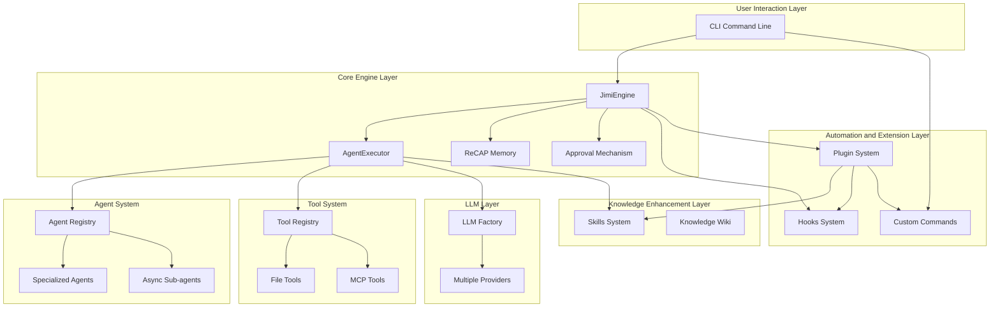

# Jimi - Building a ClaudeCode Tailored for Java Developers

<!-- hy-mt2-i18n:start -->
[中文](./README.md) | **English** | [日本語](./README_ja.md) | [Español](./README_es.md)
<!-- hy-mt2-i18n:end -->


An AI-driven intelligent agent system implemented purely in Java, offering open-source CLI tools that provide Java developers with a ClaudeCode-like experience.

[](https://www.oracle.com/java/)
[](https://spring.io/projects/spring-boot)
[](LICENSE)

## 📋 Table of Contents

- [Core Features](#-核心特性)
- [Loop Engineering](#-loop-engineering)
- [Getting Started](#-快速开始)
- [System Architecture](#-系统架构)
- [User Guide](#-使用指南)
- [Extension Development](#-扩展开发)
- [Plugin System](#-插件系统)
- [Documentation Resources](#-文档资源)

## ✨ Core Features

### 🤖 Multi-Agent Intelligent Collaboration

6 built-in professional Agents cover the entire development process:

| Agent | Responsibilities |
|-------|------------------|
| **Default** | General development assistant |
| **Architect** | Architecture design |
| **Code** | Coding implementation |
| **Quality** | Code quality and review |
| **Doc** | Documentation writing |
| **DevOps** | Deployment and operations |

- Async sub-agents: Background tasks do not block the main conversation  
- Dynamic switching: Intelligently assigns the most suitable Agent  
- YAML configuration: Customize Agents without coding required

### 🧩 Skills Package

Built-in 6 development skill packs for modular management of domain knowledge:

| Skill Pack | Function |
|---------|----------|
| api-design | API design guidelines |
| code-quality-suite | Code quality toolkit |
| database-design | Database design |
| git-commit-guide | Git commit guidelines |
| java-best-practices | Java best practices |
| unit-testing | Unit testing |

Keywords are automatically activated and loaded into the context as needed.

### 🪝 Hooks Automation System

Event-driven workflow automation:

```yaml
name: "auto-format-java"
trigger:
  type: "POST_TOOL_CALL"
  tools: ["WriteFile"]
  file_patterns: ["*.java"]
execution:
  type: "script"
  script: "google-java-format -i ${MODIFIED_FILES}"
```

Supports **15 types of Hook events** (aligning with 9 in Claude Code + 3 extensions from Jimi + 3 from Agent Teams), covering various trigger scenarios such as before and after tool calls, Agent switching, session start/end, and error handling. [Detailed documentation](docs/HOOKS.md)

### ⚡ Custom Commands

Extend commands with YAML configuration:

```yaml
name: "quick-build"
aliases: ["qb"]
execution:
  type: "script"
  script: "mvn clean install"
```

Supports three execution types: Script, Agent, and Composite. [Detailed documentation](docs/CUSTOM_COMMANDS.md)

### 🧠 Intelligent Memory Management

Context optimization based on the RECAP paper:

- Bounded activity prompt: Preventing infinite context growth  
- Structured recovery: Maintaining semantic continuity between parent and child Agents  
- Token optimization: Reducing Token consumption by 30-50%

### 🔌 Multi-Model Support

It provides unified abstraction via `ChatProvider` to support 9 types of Providers: `openai`, `kimi` (Moonshot), `qwen` (Tongyi Qianwen), `deepseek`, `claude`, `ollama`, `glm` (Zhipu), `minimax`, `cursor`. Based on the OpenAI-compatible protocol, it supports streaming responses, Caffeine caching, Token estimation, and throttling.

### 🌐 MCP Protocol Integration

Supports the Model Context Protocol, enabling integration with external tool services such as Git, GitHub, and Database.

### 🛠️ Rich Tool Ecosystem

Built-in **15 native tools** + MCP dynamic tools, covering five major categories:

- **File Operations** (5): `ReadFile`, `WriteFile`, `StrReplaceFile`, `Grep`, `Glob`  
- **Shell Execution** (1): `BashTool` command execution, background tasks  
- **Network Tools** (2): `FetchURL` for web scraping, `WebSearch` for searching  
- **Task Management** (2): `SubAgent` for synchronous/asynchronous sub-agents, `TeamAgent` for teamwork  
- **Knowledge & Interaction** (5): `Memory`, `Skills`, `SetTodoList`, `AskHuman`, `MetaTool`

All tools are executed based on the reactive (Reactor `Mono`) model, supporting concurrent safety control and automatic generation of JSON Schema.

### 📦 Plugin System

Package the five extension points of **Skills / Hooks / Commands / MCP / Agents** into a unified distributable unit:

- **One-click installation**: Use `/plugin install owner/repo` to install from GitHub, a URL, or a local directory.
- **Versionable**: Version gate via `compatibility.jimi_version` and semantic matching with `VersionRange`.
- **Auditable**: Explicitly declare exposed extensions through the `provides` allowlist.
- **Three-level scope**: classpath (built-in) < user (user-level) < project (project-level).

[Detailed Documentation](docs/PLUGIN_DEVELOPMENT.md)

### 🔐 Enterprise-Level Features

- Approval mechanism: Manual approval for sensitive operations  
- YOLO mode: Automatic approval for all operations  
- Loop control: Prevention of infinite loops  
- Session management: Persistence and breakpoint recovery  
- Context compression: Intelligent Token optimization

## 🔄 Loop Engineering

> "You shouldn’t manually prompt the Agent anymore; you should design loops to automatically drive it."

Jimi fully supports the six primitives of Loop Engineering, evolving from “manual human-driven Agents” to “system-automated Agent driving”.

### /loop — Execute at Regular Intervals

```bash
# Check the compilation status every 5 minutes and fix errors
/loop 5m Check the project's compilation status and fix any errors found

# Scan for and process TODOs every hour
/loop 1h Scan the TODO comments in src/main and select one to complete

# Control the loop
/loop status    # View status
/loop pause     # Pause
/loop resume    # Resume
/loop stop      # Stop
```

### /goal — Goal-Driven Iteration

Set verifiable goal conditions, and the Agent will keep working until those conditions are met. **Separation of validators and executors** prevents the scenario of “grading one’s own homework”.

```bash
# Until all tests pass
/goal All unit tests under src/test pass and there are no warnings from lint

# Until coverage meets the target
/goal Test coverage reaches 80%

# Complex conditions
/goal mvn test passes, checkstyle has no violations, and coverage > 80%
```

Security restrictions: a maximum of 50 iteration steps, 60-minute timeout, and a 500,000-token budget (all configurable).

### Parallel Isolation via Git Worktree

When multiple Agents work in parallel, Git Worktree is used to achieve filesystem-level isolation and prevent conflicts:

```yaml
# Enable worktree isolation in the Agent configuration
team:
  teammates:
    - teammate_id: dev-auth
      agent_path: agents/developer
      isolation: worktree     # Independent worktree
    - teammate_id: reviewer
      agent_path: agents/reviewer
      isolation: shared       # Shared main directory
```

### Loop Status Persistence

The progress of /loop is automatically written to `.jimi/progress.md`, allowing the progress to be restored even if the Agent context is compressed or reset.

### Support Matrix for the Six Core Primitives

| Primitives | Jimi Implementation | Description |
|------|----------|------|
| **Automations** | Hooks + `/loop` + `/goal` | Event-driven + scheduled scheduling + goal-driven iteration |
| **Worktrees** | WorktreeManager + SubAgent | File-system level + context level isolation |
| **Skills** | SkillRegistry + SKILL.md | Progressive disclosure, dependency declaration, automatic activation |
| **Connectors** | MCP (STDIO/HTTP) + Plugin | Integration with GitHub/Linear/Slack/DB |
| **Sub-agents** | SubAgentTool + TeamAgentTool | Separation of Maker/Checker, team collaboration |
| **State** | MEMORY.md + Session + progress.md | Three-tier memory + state file persistence |

[Detailed Documentation](docs/LOOP_ENGINEERING.md)

## 🎯 Get Started Quickly

### Environment Requirements

- Java 17+
- Maven 3.6+
- macOS / Linux / Windows

### Quick Installation

```bash
git clone https://github.com/leavesfly/Jimi.git
cd Jimi
./scripts/quick-install.sh
```

### Step-by-step Installation

```bash
# 1. Check the environment
./scripts/check-env.sh

# 2. Build the project
./scripts/build.sh

# 3. Initialize configurations
./scripts/init-config.sh

# 4. Start Jimi
./scripts/start.sh

# Start with a specific Agent
./scripts/start.sh --agent architect

# YOLO mode (automatically approve all operations)
./scripts/start.sh --yolo
```

### Command-line Arguments

`CliApplication` (based on Picocli) supports the following options:

| Parameter | Description |
|--------|-------------|
| `-w, --work-dir <path>` | Specify the working directory (defaults to the current directory) |
| `-m, --model <name>` | Override the model to use (takes precedence over Agent and global configurations) |
| `-C, --continue` | Resume from the previous session (restores `lastSessionId` based on the working directory) |
| `-y, --yolo, --yes` | YOLO mode: automatically approves all tool calls (use with caution) |
| `--agent-file <path>` | Specify a custom Agent specification file (YAML) |
| `--mcp-config-file <path>` | Load additional MCP service configurations (can be specified multiple times) |
| `-c, --command <text>` | Non-interactive: execute a single command and exit (ideal for scripts) |
| `--verbose` | Print detailed startup information |
| `--debug` | Enable debug logs (LLM requests/responses, tool calls) |

### Common Commands

| Command | Description |
|--------|-------------|
| `/help` | Help information |
| `/status` | System status |
| `/tools` | List of tools |
| `/agents` | List of Agents |
| `/switch <agent>` | Switch to the current Agent |
| `/skills` | List of skill packages |
| `/hooks list` | List of Hooks |
| `/plugin list` | List of plugins |
| `/async list` | Asynchronous tasks |
| `/memory` | Memory management |
| `/loop` | Loop scheduling |
| `/goal` | Goal-driven iteration |
| `/reset` | Clear context |
| `/config` | View configuration |
| `/version` | Version information |

## 🏛️ System Architecture



### Technology Stack

| Category | Technology |
|--------|------------|
| **Core Framework** | Spring Boot 3.2.10, WebFlux + Reactor Netty |
| **Command Line** | Picocli 4.7.6, JLine 3.25.1 |
| **Data Processing** | Jackson 2.17.0, SnakeYAML 2.2 |
| **Code Analysis** | JavaParser + symbol-solver 3.26.4 |
| **Protocol Integration** | MCP SDK 0.12.1 |
| **Process/Text** | Commons Exec 1.4.0, Commons Text 1.11.0, Jsoup 1.17.2 |
| **Caching** | Caffeine 3.2.0 |

## 📚 User Guide

### Configuring the LLM

Jimi's configuration file is located at **`~/.jimi/config.yml`** (YAML format; note that the suffix is `.yml`). It is recommended to copy the built-in default configuration from `src/main/resources/.jimi/config.yml` to `~/.jimi/config.yml` for the first use, then modify the `api_key` as needed.

An example of a minimal viable configuration:

```yaml
# Default model (must be defined in models)
default_model: qwen3-max

providers:
  qwen:
    type: qwen                                                   # One of the ProviderType enums
    base_url: https://dashscope.aliyuncs.com/compatible-mode/v1
    api_key: sk-xxxxxxxxxxxxxxxx
    rate_limit:                                                  # Optional: rate limiting
      window_ms: 4000
      max_requests: 4
      sleep_ms: 3000

models:
  qwen3-max:
    provider: qwen                                               # Corresponds to a key in providers
    model: qwen3-max                                             # Actual model name sent to the LLM API
    max_context_size: 200000                                     # Context window (Tokens)
```

`type` supports: `kimi` / `deepseek` / `qwen` / `ollama` / `openai` / `claude` / `cursor` / `glm` / `minimax`.

### Using Agents

```bash
# Switch agents
/switch architect

# View the list of agents
/agents

# Start using a specific agent
./scripts/start.sh --agent code
```

Custom Agent: Create `agent.yaml` and `system_prompt.md` files in the `~/.jimi/agents/` directory.

### Hooks Automation

Create a YAML configuration file in the `~/.jimi/hooks/` directory:

```yaml
name: "auto-test"
trigger:
  type: "POST_TOOL_CALL"
  tools: ["WriteFile"]
  file_patterns: ["*Test.java"]
execution:
  type: "script"
  script: "mvn test -Dtest=${MODIFIED_FILE%.*}"
```

[Detailed Documentation](docs/HOOKS.md)

### Custom Commands

Create a YAML configuration in `~/.jimi/commands/`:

```yaml
name: "quick-build"
aliases: ["qb"]
execution:
  type: "script"
  script: "mvn clean install"
```

[Detailed documentation](docs/CUSTOM_COMMANDS.md)

### Async Tasks

```bash
# View async tasks
/async list

# Check status
/async status <task_id>

# Cancel a task
/async cancel <task_id>
```

## 📦 Plugin System

Plugins bundle the five extension points—**Skills / Hooks / Commands / MCP / Agents**—into a distributable unit with a version number, an inventory, and the capability to be installed/uninstalled/updated as a whole.

### Installation and Management

```bash
# Install from GitHub (supports owner/repo#branch)
/plugin install leavesfly/java-dev-kit

# Install from local directory or ZIP
/plugin install./my-plugin
/plugin install./my-plugin.zip

# List / Details / Enable / Disable / Uninstall
/plugin list
/plugin info <name>
/plugin enable <name>
/plugin disable <name>
/plugin uninstall <name>
```

### Plugin List plugin.yaml

```yaml
name: java-dev-kit
version: 1.0.0
description: A comprehensive toolkit for Java development

compatibility:
  jimi_version: ">=0.1.0"      # Version threshold (matches VersionRange semantics)

provides:                       # Allowlist of extensions exposed to users
  skills: ["java-best-practices"]
  hooks: ["auto-format-java"]
  commands: ["quick-build"]

defaults:
  modules:                      # Module-level switches with grayscale enabling support
    skills: true
    hooks: true
```

The plugin follows a three-level scope hierarchy of **classpath (built-in) < user (`~/.jimi/plugins/`) < project (`<project>/.jimi/plugins/`)**, with later-loaded plugins overriding those with the same name. [Detailed documentation](docs/PLUGIN_DEVELOPMENT.md)

## 🛠️ Extension Development

### Custom Tools

```java
@Component
public class MyTool extends AbstractTool<MyTool.Params> {
    @Data
    public static class Params {
        @JsonProperty("input")
        private String input;
    }
    
    public MyTool() {
        super("my_tool", "My Tool", Params.class);
    }
    
    @Override
    public Mono<ToolResult> execute(Params params) {
        return Mono.just(ToolResult.ok("Result"));
    }
}
```

### Custom Agent

Create a configuration file in `~/.jimi/agents/my-agent/`:

**agent.yaml**
```yaml
name: My Agent
model: qwen3-max          # Use the model name defined in config.yml's models field (uses default_model if left empty)
tools:
  - ReadFile
  - WriteFile
  - my_tool
```

**system_prompt.md**
```markdown
You are a professional development assistant...
```

### Custom Skill

Create a `SKILL.md` file (Markdown + YAML Front Matter) in `~/.jimi/skills/<name>/` to automatically activate based on trigger words and inject the system prompt:

```markdown
---
name: java-best-practices
description: Best practices for Java coding
triggers: ["best practices", "code standards", "refactoring"]
---

# Java Best Practices
- Prefer immutable objects...
```

### Custom Commands

Create a YAML configuration in `~/.jimi/commands/` to support four execution types:
- **script**: Execute a Shell script
- **agent**: Call an Agent to execute tasks
- **composite**: Combine multiple commands
- **prompt**: Use a fixed prompt template

Tip: Use the above extension points for individual small skills; when there are more than 2 extensions or team sharing is needed, it is recommended to upgrade to [plugins](#-plugin-system) for unified distribution.

### User-Focused Documentation (docs/)

| Document | Description |
|------|------------|
| [User Guide](用户使用指南.md) | Complete user manual |
| [HOOKS](docs/HOOKS.md) | Hooks system guide |
| [Custom Commands](docs/CUSTOM_COMMANDS.md) | Command extension guide |
| [Plugin Development](docs/PLUGIN_DEVELOPMENT.md) | Plugin development manual |
| [Loop Engineering](docs/LOOP_ENGINEERING.md) | Loop iteration engineering guide |
| [Technical Architecture](docs/TECHNICAL_ARCHITECTURE.md) | Detailed explanation of system architecture |
| [Architecture Overview](docs/ARCHITECTURE_OVERVIEW.md) | Architecture overview |

### Developer Perspective Documentation (wiki/)

To delve into the source code, understand mechanisms, locate code, and perform secondary extensions, see **[Wiki Homepage](wiki/Home.md)** for details:

| Wiki | Topic |
|------|------|
| [01 · Project Overview and Getting Started](wiki/01-Project Overview and Getting Started.md) | Project positioning, technology stack, getting started |
| [02 · System Architecture and Core Engine](wiki/02-System Architecture and Core Engine.md) | JimiEngine / AgentExecutor / ReactLoop |
| [03 · Agent Multi-Agent System](wiki/03-Agent Multi-Agent System.md) | Agent, AgentRegistry, asynchronous Subagent, Team |
| [04 · Tool System and ToolRegistry](wiki/04-Tool System and ToolRegistry.md) | Tool SPI, 15 built-in tools, MCP dynamic tools |
| [05 · LLM Integration Layer and Multi-Model Support](wiki/05-LLM Integration Layer and Multi-Model Support.md) | ChatProvider, streaming, caching, rate limiting |
| [06 · Skills Package System](wiki/06-Skills Package System.md) | Skill package specifications, trigger words, progressive disclosure |
| [07 · Hooks Automation System](wiki/07-Hooks Automation System.md) | 15 types of Hook events, triggers, and executors |
| [09 · Custom Commands and CLI Interaction](wiki/09-Custom Commands and CLI Interaction.md) | Meta-commands, 4 execution types, JLine Shell |
| [10 · Memory Management and Session Mechanism](wiki/10-Memory Management and Session Mechanism.md) | Three-tier memory, ReCAP compression, approval, and YOLO |
| [11 · MCP Protocol Integration](wiki/11-MCP Protocol Integration.md) | MCP client,stdio/http transmission |
| [12 · Extension Development Guide](wiki/12-Extension Development Guide.md) | Customizing Tool/Agent/Skill/Hook/Command |
| [13 · Plugin System and Extension Distribution](wiki/13-Plugin System and Extension Distribution.md) | PluginRegistry, installer, version ranges |

## 🤝 Contribution Guide

Contributions are welcome!

```bash
# Fork and clone
git clone https://github.com/your-username/Jimi.git

# Create a branch
git checkout -b feature/my-feature

# Develop and test
mvn clean test

# Commit the changes
git commit -m "feat: add my feature"

# Push and create a Pull Request
git push origin feature/my-feature
```

### Development Guidelines

- Follow Java coding conventions  
- Write unit tests  
- Update relevant documentation  
- Maintain backward compatibility

## 📜 License

This project is licensed under the [Apache License 2.0](LICENSE).

# Strict Constraints
1. **Structure Locking**: Maintain the original Markdown data structure, indentation, heading levels, tables, links, URLs, badges, code blocks, and inline codes exactly as they are.
2. **Selective Translation**: Only translate the visible natural language content intended for users.
3. **Prohibition of Modifications**: It is **strictly forbidden** to translate or alter code tags, key names, variable placeholders (such as {{var}}, ${var}, %s, %d, etc.), command examples, file paths, project names, API names, package names, model names, identifiers, and code symbols; unless a corresponding translation is already provided in the background information.
4. The translations of terms, styles, and proper nouns should be consistent with those in the given background information.

<div align="center">

**[⬆ Back to Top](#jimi---Building a Claude-like Code Editor for Java Developers)**

Created with ❤️ by [Leavesfly](https://github.com/leavesfly)

</div>
