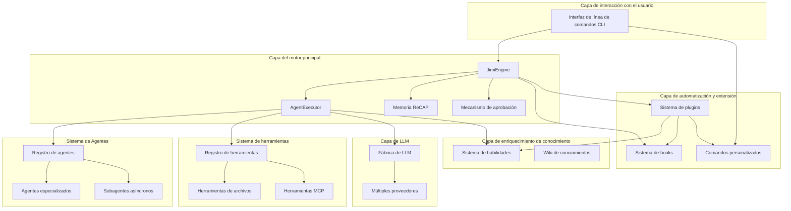

# Jimi: Crea una experiencia ClaudeCode exclusiva para desarrolladores de Java

<!-- hy-mt2-i18n:start -->
[中文](./README.md) | [English](./README_en.md) | [日本語](./README_ja.md) | **Español**
<!-- hy-mt2-i18n:end -->


Sistema de agentes inteligentes impulsado por IA implementado íntegramente en Java, una herramienta CLI de código abierto que brinda a los desarrolladores en Java una experiencia similar a la de ClaudeCode.

[](https://www.oracle.com/java/)
[](https://spring.io/projects/spring-boot)
[](LICENSE)

## 📋 Índice

- [Características principales](#-核心特性)
- [Loop Engineering](#-loop-engineering)
- [Inicio rápido](#-快速开始)
- [Arquitectura del sistema](#-系统架构)
- [Guía de uso](#-使用指南)
- [Desarrollo de extensiones](#-扩展开发)
- [Sistema de plugins](#-插件系统)
- [Recursos documentales](#-文档资源)

## ✨ Características principales

### 🤖 Colaboración inteligente multi-Agent

Incluye 6 Agentes especializados que abarcan todo el proceso de desarrollo:

| Agente | Responsabilidades |
|-------|------------------|
| **Default** | Asistente general para desarrollo |
| **Architect** | Diseño de arquitectura |
| **Code** | Implementación mediante codificación |
| **Quality** | Calidad del código y revisión |
| **Doc** | Redacción de documentación |
| **DevOps** | Despliegue y operaciones |

- Subagentes asíncronos: las tareas en segundo plano no bloquean la conversación principal  
- Cambio dinámico: asignación inteligente del Agent más adecuado  
- Configuración en YAML: personalización de Agentes sin necesidad de programar

### 🧩 Paquetes de habilidades

Incluye 6 paquetes de habilidades para desarrollo, con gestión modular de conocimientos especializados:

| Paquete de habilidades | Funciones |
|-------|------|
| api-design | Especificaciones de diseño de API |
| code-quality-suite | Kit de calidad de código |
| database-design | Diseño de bases de datos |
| git-commit-guide | Pautas para commits en Git |
| java-best-practices | Mejores prácticas en Java |
| unit-testing | Pruebas unitarias |

Las palabras clave se activan automáticamente y se cargan en el contexto según sea necesario.

### 🪝 Sistema de automatización de Hooks

Automatización de flujos de trabajo basada en eventos:

```yaml
name: "auto-format-java"
trigger:
  type: "POST_TOOL_CALL"
  tools: ["WriteFile"]
  file_patterns: ["*.java"]
execution:
  type: "script"
  script: "google-java-format -i ${MODIFIED_FILES}"
```

Soporta **15 tipos de eventos Hook** (9 alineados con Claude Code + 3 extensiones de Jimi + 3 extensiones de Agent Teams), que abarcan momentos de activación como antes y después de las llamadas a herramientas, cambio de Agent, inicio/finalización de sesiones y manejo de errores.[Documentación detallada](docs/HOOKS.md)

### ⚡ Comandos personalizados

Se pueden extender comandos mediante configuración YAML.

```yaml
name: "quick-build"
aliases: ["qb"]
execution:
  type: "script"
  script: "mvn clean install"
```

Soporta tres tipos de ejecución: Script, Agent y Composite. [Documentación detallada](docs/CUSTOM_COMMANDS.md)

### 🧠 Gestión inteligente de la memoria

Optimización del contexto basada en el trabajo de investigación ReCAP:

- Notificación de actividad limitada: evita el crecimiento infinito del contexto  
- Recuperación estructurada: continuidad semántica entre agentes padre e hijo  
- Optimización de tokens: ahorra del 30 al 50 % en el consumo de tokens

### 🔌 Soporte para múltiples modelos

Gracias a la abstracción mediante un `ChatProvider` unificado, se brinda soporte para 9 tipos de proveedores: `openai`, `kimi` (Moonshot), `qwen` (Tongyi Qianwen), `deepseek`, `claude`, `ollama`, `glm` (Zhipu), `minimax` y `cursor`. Basado en el protocolo compatible con OpenAI, permite respuestas en flujo continuo, caché Caffeine, estimación de tokens y control de ancho de banda.

### 🌐 Integración con el protocolo MCP

Soporta el Model Context Protocol y permite integrar servicios de herramientas externas (Git, GitHub, bases de datos, etc.).

### 🛠️ Ecosistema rico de herramientas

Incluye **15 herramientas nativas** + herramientas dinámicas MCP, que abarcan cinco categorías principales:

- **Operaciones con archivos** (5): `ReadFile`, `WriteFile`, `StrReplaceFile`, `Grep`, `Glob`
- **Ejecución en shell** (1): ejecución de comandos `BashTool` y tareas en segundo plano
- **Herramientas de red** (2): extracción de páginas web con `FetchURL` y búsqueda con `WebSearch`
- **Gestión de tareas** (2): subagentes síncronos/asíncronos `SubAgent` y colaboración en equipo `TeamAgent`
- **Conocimiento e interacción** (5): `Memory`, `Skills`, `SetTodoList`, `AskHuman`, `MetaTool`

Todas las herramientas se ejecutan mediante un modelo reactivo (Reactor `Mono`), lo que permite el control seguro de la concurrencia y la generación automática de JSON Schema.

### 📦 Sistema de plugins

Empaquetar los cinco puntos de extensión **Skills / Hooks / Commands / MCP / Agents** en una unidad unificada listo para distribuir:

- **Instalación con un clic**: ` /plugin install owner/repo ` para instalar desde GitHub, una URL o un directorio local.  
- **Versionable**: control de acceso por versión mediante `compatibility.jimi_version` y coincidencia semántica con `VersionRange`.  
- **Auditable**: las extensiones expuestas se declaran explícitamente en la lista blanca a través de `provides`.  
- **Tres niveles de escopo**: `classpath` (integrado) < `user` (nivel de usuario) < `project` (nivel de proyecto).

[Documentación detallada](docs/PLUGIN_DEVELOPMENT.md)

### 🔐 Funcionalidades a nivel empresarial

- Mecanismo de aprobación: Aprobación manual para operaciones sensibles  
- Modo YOLO: Aprobación automática de todas las operaciones  
- Control de bucles: Prevención de bucles infinitos  
- Gestión de sesiones: Persistencia y recuperación desde puntos de interrupción  
- Compresión de contexto: Optimización inteligente de tokens

## 🔄 Ingeniería de bucles

> “Ya no deberías promover manualmente al Agent; en su lugar, debes diseñar bucles para hacer que tu Agent funcione de forma automática.”

Jimi admite plenamente los seis primitivos de Loop Engineering, evolucionando de un modelo en el que el humano controla manualmente al Agent a uno en el que el sistema lo impulsa automáticamente.

### /loop — Ejecutar de forma repetida a intervalos regulares

```bash
# Verificar el estado de compilación cada 5 minutos y corregir errores
/loop 5m Verificar el estado de compilación del proyecto; si hay errores, corregirlos.

# Escanear y procesar tareas pendientes cada hora
/loop 1h Escanear los comentarios TODO en src/main y seleccionar uno para completarlo.

# Controlar el bucle
/loop status    # Verificar el estado
/loop pause     # Pausar
/loop resume    # Reanudar
/loop stop      # Detener
```

### /goal — Iteración impulsada por objetivos

Establezca condiciones de objetivo verificables; el agente seguirá trabajando hasta que se cumplan dichas condiciones. La **separación entre el verificador y el ejecutor** evita que alguien revise su propio trabajo.

```bash
# Hasta que todas las pruebas pasen
/goal Todas las pruebas unitarias en src/test pasen y no haya advertencias en lint

# Hasta que se alcance el porcentaje de cobertura deseado
/goal El porcentaje de cobertura de pruebas llegue al 80%

# Condiciones compuestas
/goal mvn test pase, checkstyle no tenga infracciones y el porcentaje de cobertura sea superior al 80%
```

Restricciones de seguridad: un máximo de 50 iteraciones, tiempo de espera de 60 minutos y un presupuesto de 500,000 tokens (todos configurables).

### Aislamiento paralelo con Git Worktree

Cuando varios Agentes trabajan en paralelo, se logra el aislamiento a nivel del sistema de archivos mediante Git Worktree para evitar conflictos:

```yaml
# Habilitar el aislamiento mediante worktree en la configuración del agente
team:
  teammates:
    - teammate_id: dev-auth
      agent_path: agents/developer
      isolation: worktree     # worktree independiente
    - teammate_id: reviewer
      agent_path: agents/reviewer
      isolation: shared       # directorio principal compartido
```

### Persistencia del estado de Loop

El progreso del /loop se escribe automáticamente en `.jimi/progress.md`, por lo que se puede recuperar incluso después de comprimir o restablecer el contexto del Agent.

### Matriz de soporte para los seis primitivos

| Primitivo | Implementación en Jimi | Descripción |
|------|----------|------|
| **Automatizaciones** | Hooks + `/loop` + `/goal` | Impulsado por eventos + programación por horarios + iteración basada en objetivos |
| **Worktrees** | WorktreeManager + SubAgent | Aislamiento a nivel del sistema de archivos + a nivel de contexto |
| **Habilidades** | SkillRegistry + SKILL.md | Revelación progresiva, declaración de dependencias, activación automática |
| **Conectores** | MCP (STDIO/HTTP) + Plugin | Conexión con GitHub/Linear/Slack/DB |
| **Subagentes** | SubAgentTool + TeamAgentTool | Separación entre creador y verificador, colaboración en equipo |
| **Estado** | MEMORY.md + Session + progress.md | Tres niveles de memoria + persistencia de archivos de estado |

[Documentación detallada](docs/LOOP_ENGINEERING.md)

## 🎯 Comenzar rápidamente

### Requisitos del entorno

- Java 17+  
- Maven 3.6+  
- macOS / Linux / Windows

### Instalación rápida

```bash
git clone https://github.com/leavesfly/Jimi.git
cd Jimi
./scripts/quick-install.sh
```

### Instalación paso a paso

```bash
# 1. Verificar el entorno
./scripts/check-env.sh

# 2. Compilar el proyecto
./scripts/build.sh

# 3. Inicializar la configuración
./scripts/init-config.sh

# 4. Iniciar Jimi
./scripts/start.sh

# Iniciar con un Agente específico
./scripts/start.sh --agent architect

# Modo YOLO (aprobación automática de todas las operaciones)
./scripts/start.sh --yolo
```

### Parámetros de la línea de comandos

`CliApplication` (basado en Picocli) admite las siguientes opciones:

| Parámetro | Descripción |
|--------|-------------|
| `-w, --work-dir <ruta>` | Especificar el directorio de trabajo (por defecto, el directorio actual) |
| `-m, --model <nombre>` | Sobrescribir el modelo a utilizar (tiene prioridad sobre los Agentes y la configuración global) |
| `-C, --continue` | Continuar con la sesión anterior (restaurar `lastSessionId` según el directorio de trabajo) |
| `-y, --yolo, --yes` | Modo YOLO: aprobar automáticamente todas las llamadas a herramientas (usar con precaución) |
| `--agent-file <ruta>` | Especificar un archivo personalizado con las especificaciones del Agent (formato YAML) |
| `--mcp-config-file <ruta>` | Cargar adicionalmente la configuración del servicio MCP (puede especificarse varias veces) |
| `-c, --command <texto>` | No interactivo: ejecutar un único comando y luego salir (ideal para scripts) |
| `--verbose` | Imprimir información detallada sobre el inicio |
| `--debug` | Habilitar registros de depuración (solicitudes/respuestas de LLM, llamadas a herramientas) |

### Comandos comunes

| Comando | Descripción |
|--------|-------------|
| `/help` | Información de ayuda |
| `/status` | Estado del sistema |
| `/tools` | Lista de herramientas |
| `/agents` | Lista de agentes |
| `/switch <agent>` | Cambiar el agente actual |
| `/skills` | Lista de paquetes de habilidades |
| `/hooks list` | Lista de ganchos |
| `/plugin list` | Lista de plugins |
| `/async list` | Tareas asíncronas |
| `/memory` | Gestión de la memoria |
| `/loop` | Programación por bucles |
| `/goal` | Iteración orientada a objetivos |
| `/reset` | Eliminar el contexto |
| `/config` | Ver la configuración |
| `/version` | Información de versión |

## 🏛️ Arquitectura del sistema



### Stack tecnológico

| Categoría | Tecnología |
|----------|------------|
| **Marco principal** | Spring Boot 3.2.10, WebFlux + Reactor Netty |
| **Línea de comandos** | Picocli 4.7.6, JLine 3.25.1 |
| **Procesamiento de datos** | Jackson 2.17.0, SnakeYAML 2.2 |
| **Análisis de código** | JavaParser + symbol-solver 3.26.4 |
| **Integración de protocolos** | MCP SDK 0.12.1 |
| **Procesos/texto** | Commons Exec 1.4.0, Commons Text 1.11.0, Jsoup 1.17.2 |
| **Caché** | Caffeine 3.2.0 |

## 📚 Guía de uso

### Configuración de LLM

El archivo de configuración de Jimi se encuentra en **`~/.jimi/config.yml`** (formato YAML; tenga en cuenta que el sufijo es `.yml`). Se recomienda copiar la configuración predeterminada incluida en `src/main/resources/.jimi/config.yml` a `~/.jimi/config.yml` la primera vez que lo utilice, y luego modificar el `api_key` según sea necesario.

Un ejemplo de configuración mínima funcional:

```yaml
# Modelo predeterminado (debe estar definido en models)
default_model: qwen3-max

providers:
  qwen:
    type: qwen                                                   # Uno de los valores de la enumeración ProviderType
    base_url: https://dashscope.aliyuncs.com/compatible-mode/v1
    api_key: sk-xxxxxxxxxxxxxxxx
    rate_limit:                                                  # Opcional: límite de frecuencia
      window_ms: 4000
      max_requests: 4
      sleep_ms: 3000

models:
  qwen3-max:
    provider: qwen                                               # Una de las claves correspondientes a providers
    model: qwen3-max                                             # Nombre real del modelo que se enviará a la API del LLM
    max_context_size: 200000                                     # Tamaño del contexto (tokens)
```

Valores permitidos para `type`: `kimi` / `deepseek` / `qwen` / `ollama` / `openai` / `claude` / `cursor` / `glm` / `minimax`.

### Uso de Agentes

```bash
# Cambiar de agente
/switch architect

# Ver la lista de agentes
/agents

# Iniciar con un agente específico
./scripts/start.sh --agent code
```

Agente personalizado: Cree los archivos `agent.yaml` y `system_prompt.md` en el directorio `~/.jimi/agents/`.

### Automatización de hooks

Cree un archivo de configuración YAML en el directorio `~/.jimi/hooks/`:

```yaml
name: "auto-test"
trigger:
  type: "POST_TOOL_CALL"
  tools: ["WriteFile"]
  file_patterns: ["*Test.java"]
execution:
  type: "script"
  script: "mvn test -Dtest=${MODIFIED_FILE%.*}"
```

[Documentación detallada](docs/HOOKS.md)

### Comandos personalizados

Cree un archivo de configuración YAML en `~/.jimi/commands/`:

```yaml
name: "quick-build"
aliases: ["qb"]
execution:
  type: "script"
  script: "mvn clean install"
```

[Documentación detallada](docs/CUSTOM_COMMANDS.md)

### Tareas asíncronas

```bash
# Ver tareas asíncronas
/async list

# Ver el estado
/async status <task_id>

# Cancelar tarea
/async cancel <task_id>
```

## 📦 Sistema de complementos

El plugin agrupa los cinco puntos de extensión **Skills / Hooks / Commands / MCP / Agents** en una unidad de distribución con número de versión, lista detallada, y que permite su instalación, desinstalación y actualización integral.

### Instalación y gestión

```bash
# Instalar desde GitHub (soporta owner/repo#branch)
/plugin install leavesfly/java-dev-kit

# Instalar desde un directorio local o ZIP
/plugin install./my-plugin
/plugin install./my-plugin.zip

# Listar / Ver detalles / Habilitar / Deshabilitar / Desinstalar
/plugin list
/plugin info <name>
/plugin enable <name>
/plugin disable <name>
/plugin uninstall <name>
```

### Lista de plugins plugin.yaml

```yaml
name: java-dev-kit
version: 1.0.0
description: Kit completo para desarrollo en Java

compatibility:
  jimi_version: ">=0.1.0"      # Requisito de versión (coincidencia semántica de VersionRange)

provides:                       # Lista blanca de extensiones expuestas al exterior
  skills: ["java-best-practices"]
  hooks: ["auto-format-java"]
  commands: ["quick-build"]

defaults:
  modules:                      # Interruptores a nivel de módulo, con soporte para activación gradual
    skills: true
    hooks: true
```

El complemento sigue un escopo de tres niveles: **classpath (integrado) < user (`~/.jimi/plugins/`) < project (`<project>/.jimi/plugins/`)**, donde los cargados con el mismo nombre sobrescriben a los anteriores. [Documentación detallada](docs/PLUGIN_DEVELOPMENT.md)

## 🛠️ Desarrollo de extensiones

### Herramientas personalizadas

```java
@Component
public class MyTool extends AbstractTool<MyTool.Params> {
    @Data
    public static class Params {
        @JsonProperty("input")
        private String input;
    }
    
    public MyTool() {
        super("my_tool", "Mi herramienta", Params.class);
    }
    
    @Override
    public Mono<ToolResult> execute(Params params) {
        return Mono.just(ToolResult.ok("Resultado"));
    }
}
```

### Agente personalizado

Cree un archivo de configuración en `~/.jimi/agents/my-agent/`:

**agent.yaml**
```yaml
name: Mi Agente
model: qwen3-max          # Nombre del modelo definido en models de config.yml (si se deja vacío, se usará default_model)
tools:
  - ReadFile
  - WriteFile
  - my_tool
```

**system_prompt.md**
```markdown
Eres un asistente de desarrollo profesional...
```

### Skill personalizada

Cree un archivo `SKILL.md` (Markdown + YAML Front Matter) en `~/.jimi/skills/<name>/`, que se activará automáticamente según las palabras desencadenantes e insertará el system prompt:

```markdown
---
name: java-best-practices
description: Mejores prácticas de codificación en Java
triggers: ["mejores prácticas", "estándares de código", "refactorización"]
---

# Mejores prácticas de Java
- Priorizar el uso de objetos inmutables...
```

### Comandos personalizados

Cree una configuración en YAML en `~/.jimi/commands/` que soporte cuatro tipos de ejecución:
- **script**: Ejecutar scripts Shell
- **agent**: Llamar a un Agente para ejecutar
- **composite**: Combinar múltiples comandos
- **prompt**: Usar un plantilla de prompt fijo

> Sugerencia: Utilice los puntos de extensión mencionados para habilidades pequeñas individuales; si hay más de 2 elementos de extensión o es necesario compartirlos con el equipo, se recomienda pasar a [plugins](#-插件系统) para una distribución unificada.

### Documentación desde la perspectiva del usuario (docs/)

| Documento | Descripción |
|----------|-------------|
| [Guía de uso para usuarios](用户使用指南.md) | Manual completo para usuarios |
| [HOOKS](docs/HOOKS.md) | Guía del sistema de Hooks |
| [Comandos personalizados](docs/CUSTOM_COMMANDS.md) | Guía de extensión de comandos |
| [Desarrollo de plugins](docs/PLUGIN_DEVELOPMENT.md) | Manual de desarrollo de plugins |
| [Loop Engineering](docs/LOOP_ENGINEERING.md) | Guía de ingeniería de bucles Loop |
| [Arquitectura técnica](docs/TECHNICAL_ARCHITECTURE.md) | Explicación detallada de la arquitectura del sistema |
| [Visión general de la arquitectura](docs/ARCHITECTURE_OVERVIEW.md) | Resumen de la arquitectura |

### Documentación desde la perspectiva del desarrollador (wiki/)

Para adentrarse en el código fuente, comprender los mecanismos, localizar el código y realizar extensiones adicionales, consulte la **[página principal de Wiki](wiki/Home.md)**:

| Wiki | Tema |
|------|------|
| [01 · Visión general del proyecto e inicio rápido](wiki/01-项目概述与快速开始.md) | Posicionamiento del proyecto, stack tecnológico, primeros pasos |
| [02 · Arquitectura del sistema y motor principal](wiki/02-系统架构与核心引擎.md) | JimiEngine / AgentExecutor / ReactLoop |
| [03 · Sistema de agentes multiagente](wiki/03-Agent多智能体系统.md) | Agent, AgentRegistry, Subagent asíncrono, Team |
| [04 · Sistema de herramientas y ToolRegistry](wiki/04-工具系统与ToolRegistry.md) | Tool SPI, 15 herramientas integradas, herramientas dinámicas MCP |
| [05 · Capa de integración con LLM y soporte para múltiples modelos](wiki/05-LLM接入层与多模型支持.md) | ChatProvider, flujo en tiempo real, caché, limitación de tráfico |
| [06 · Sistema de paquetes de habilidades Skills](wiki/06-Skills技能包系统.md) | Especificaciones de los paquetes de habilidades, palabras desencadenantes, revelación progresiva |
| [07 · Sistema de automatización con Hooks](wiki/07-Hooks自动化系统.md) | 15 tipos de eventos Hook, desencadenadores y ejecutores |
| [09 · Comandos personalizados e interacción con CLI](wiki/09-自定义命令与CLI交互.md) | Comandos meta, 4 tipos de ejecución, JLine Shell |
| [10 · Gestión de memoria y mecanismo de sesiones](wiki/10-记忆管理与会话机制.md) | Memoria en tres capas, compresión ReCAP, aprobación y YOLO |
| [11 · Integración del protocolo MCP](wiki/11-MCP协议集成.md) | Cliente MCP, transmisión mediantestdio/http |
| [12 · Guía para el desarrollo de extensiones](wiki/12-扩展开发指南.md) | Personalización de Tool/Agent/Skill/Hook/Command |
| [13 · Sistema de plugins y distribución de extensiones](wiki/13-插件系统与扩展分发.md) | PluginRegistry, instalador, rangos de versiones |

## 🤝 Guía para contribuir

¡Bienvenidos a contribuir!

```bash
# Hacer fork y clonar
git clone https://github.com/tu-usuario/Jimi.git

# Crear una rama
git checkout -b feature/mi-caracteristica

# Desarrollar y probar
mvn clean test

# Commit de los cambios
git commit -m "feat: agregar mi característica"

# Subir los cambios y crear una Pull Request
git push origin feature/mi-caracteristica
```

### Especificaciones de desarrollo

- Seguir las normas de codificación de Java  
- Escribir pruebas unitarias  
- Actualizar la documentación correspondiente  
- Mantener la compatibilidad retroactiva

## 📜 Licencia

Este proyecto está licenciado bajo la [Apache License 2.0](LICENSE).

# Restricciones estrictas
1. **Bloqueo de estructura**: Mantener absolutamente intacta la estructura de datos Markdown original, los sangrados, los niveles de título, las tablas, los enlaces, las URL, las insignias, los bloques de código y el código inline.
2. **Traducción selectiva**: Solo traducir el contenido de lenguaje natural visible para el usuario.
3. **Prohibición de modificaciones**: Está **estrictamente prohibido** traducir o modificar etiquetas de código, nombres de claves, placeholders de variables (como {{var}}, ${var}, %s, %d, etc.), ejemplos de comandos, rutas de archivos, nombres de proyectos, nombres de API, nombres de paquetes, nombres de modelos, identificadores y símbolos de código; a menos que ya se haya proporcionado una traducción correspondiente en la información de contexto.
4. Las traducciones de términos, estilos y nombres propios deben ser consistentes con la información de contexto proporcionada.

<div align="center">

**[⬆ Volver arriba](#jimi---Crear ClaudeCode exclusivo para programadores en Java)**

Creado con ❤️ por [Leavesfly](https://github.com/leavesfly)

</div>
