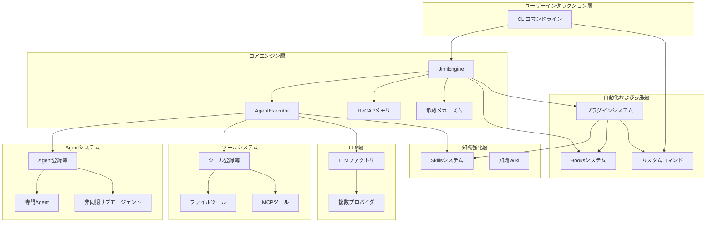

# Jimi - Javaプログラマー専用のClaudeCodeを実現

<!-- hy-mt2-i18n:start -->
[中文](./README.md) | [English](./README_en.md) | **日本語** | [Español](./README_es.md)
<!-- hy-mt2-i18n:end -->


純Javaで実装されたAI駆動のスマートエージェントシステムで、Java開発者にClaudeCodeに似た体験を提供するオープンソースのCLIツールです。

[](https://www.oracle.com/java/)
[](https://spring.io/projects/spring-boot)
[](LICENSE)

## 📋 目次

- [核心特性](#-核心特性)
- [Loop Engineering](#-loop-engineering)
- [快速开始](#-快速开始)
- [系统架构](#-系统架构)
- [使用指南](#-使用指南)
- [扩展开发](#-扩展开发)
- [插件系统](#-插件系统)
- [文档资源](#-文档资源)

## ✨ コア機能

### 🤖 複数エージェントによるインテリジェントな連携

開発の全プロセスをカバーする6つの専門的なAgentが内蔵されています：

| Agent | 職責 |
|-------|------|
| **Default** | 一般開発アシスタント |
| **Architect** | アーキテクチャ設計 |
| **Code** | コーディング実装 |
| **Quality** | コード品質とレビュー |
| **Doc** | ドキュメント作成 |
| **DevOps** | デプロイメントと運用管理 |

- 非同期サブエージェント：バックグラウンドタスクがメイン対話をブロックしない  
- 動的切り替え：最適なエージェントを自動的に割り当てる  
- YAML設定：コーディング不要でカスタムエージェントを定義可能

### 🧩 スキルパッケージ

開発に特化した6つのスキルパックを内蔵し、ドメイン知識をモジュール単位で管理しています：

| スキルパック | 機能 |
|-------|------|
| api-design | API設計規約 |
| code-quality-suite | コード品質スイート |
| database-design | データベース設計 |
| git-commit-guide | Gitコミット規約 |
| java-best-practices | Javaのベストプラクティス |
| unit-testing | 単体テスト |

キーワードにより自動的にアクティブ化され、必要に応じてコンテキストに読み込まれます。

### 🪝 Hooks自動化システム

イベント駆動型のワークフロー自動化：

```yaml
name: "auto-format-java"
trigger:
  type: "POST_TOOL_CALL"
  tools: ["WriteFile"]
  file_patterns: ["*.java"]
execution:
  type: "script"
  script: "google-java-format -i ${MODIFIED_FILES}"
```

**15種類のHookイベント**に対応しており（Claude Codeの9種類＋Jimi拡張の3種類＋Agent Teams拡張の3種類）、ツール呼び出しの前後、Agentの切り替え、セッションの開始/終了、エラー処理など、さまざまなトリガーポイントをカバーしています。[詳細ドキュメント](docs/HOOKS.md)

### ⚡ カスタムコマンド

YAML設定だけでコマンドを拡張できます：

```yaml
name: "quick-build"
aliases: ["qb"]
execution:
  type: "script"
  script: "mvn clean install"
```

Script、Agent、Compositeの3つの実行タイプをサポートしています。[詳細ドキュメント](docs/CUSTOM_COMMANDS.md)

### 🧠 スマートメモリ管理

ReCAP論文に基づくコンテキスト最適化：

- 有界アクティビティ通知：コンテキストの無限増大を防ぐ
- 構造化復元：親子Agent間の意味の連続性を保つ
- Token最適化：Token消費量を30～50％削減する

### 🔌 複数モデル対応

統一された `ChatProvider` によって抽象化が行われ、`openai`、`kimi`（Moonshot）、`qwen`（通義千問）、`deepseek`、`claude`、`ollama`、`glm`（智谱）、`minimax`、`cursor` の計9種類のProviderがサポートされています。OpenAI互換プロトコルに基づき、ストリーム型の応答、Caffeineキャッシュ、Tokenの推定および制限なども対応しています。

### 🌐 MCPプロトコルの統合

Model Context Protocolに対応し、Git、GitHub、Databaseなどの外部ツールサービスを統合できます。

### 🛠️ 豊富なツールエコシステム

組み込みの**15個のネイティブツール**に加えてMCP動的ツールがあり、5つのカテゴリーを網羅しています：

- **ファイル操作**（5）：`ReadFile`、`WriteFile`、`StrReplaceFile`、`Grep`、`Glob`
- **シェル実行**（1）：`BashTool` コマンドの実行、バックグラウンドタスク
- **ネットワークツール**（2）：`FetchURL` によるウェブページの取得、`WebSearch` による検索
- **タスク管理**（2）：`SubAgent` による同期/非同期のサブエージェント、`TeamAgent` によるチーム連携
- **知識とインタラクション**（5）：`Memory`、`Skills`、`SetTodoList`、`AskHuman`、`MetaTool`

すべてのツールはリアクティブ（Reactor `Mono`）方式で実行され、並行処理時の安全性制御やJSON Schemaの自動生成をサポートしています。

### 📦 プラグインシステム

**Skills / Hooks / Commands / MCP / Agents**の5つの拡張ポイントを、統一された配布可能なユニットとしてまとめます：

- **ワンクリックインストール**：`/plugin install owner/repo` を使用してGitHub、URL、またはローカルディレクトリからインストール可能
- **バージョン管理対応**：`compatibility.jimi_version` によるバージョン制御と、`VersionRange` による意味論的なマッチング
- **監査機能付き**：`provides` を用いて、外部に公開する拡張機能を明示的に宣言可能
- **3層のスコープ構造**：classpath（組み込み）< user（ユーザーレベル）< project（プロジェクトレベル）

[詳細ドキュメント](docs/PLUGIN_DEVELOPMENT.md)

### 🔐 企業向け機能

- 認可メカニズム：機密性の高い操作は人手による承認が必要  
- YOLOモード：すべての操作を自動的に承認  
- ループ制御：無限ループの発生を防ぐ  
- セッション管理：データの永続化と中断時の復元  
- コンテキスト圧縮：スマートなToken最適化

## 🔄 ループエンジニアリング

もはや手動でAgentにプロンプトを送るべきではありません。代わりに、ループを設計してAgentを自動的に駆動させるべきです。

JimiはLoop Engineeringの6つのプリミティブを完全にサポートしており、「人が手動でAgentを操作する」方式から「システムが自動的にAgentを駆動する」方式へと進化しています。

### /loop — 一定間隔で繰り返し実行

```bash
# 5分ごとにコンパイル状況をチェックし、エラーを修正する
/loop 5m プロジェクトのコンパイル状況をチェックし、エラーがあれば修正する

# 1時間ごとにTODOをスキャンして処理する
/loop 1h src/main内のTODOコメントをスキャンし、1つを選んで処理する

# ループの制御
/loop status    # ステータスを確認する
/loop pause     # 一時停止する
/loop resume    # 再開する
/loop stop      # 停止する
```

### /goal — 目標駆動型反復処理

検証可能な目標条件を設定し、エージェントはその条件が満たされるまで継続して動作します。**検証者と実行者を分離**することで、「自分で自分の宿題を採点する」状況を避けます。

```bash
# すべてのテストが通るまで
/goal src/test 内のすべての単体テストが通過し、lintで警告が出ない状態になるまで

# コバーエッジが目標値に達するまで
/goal テストのコバーエッジが80％に達するまで

# 複合条件
/goal mvn testが通過し、checkstyleで違反がなく、かつコバーエッジが80％を超えるまで
```

セキュリティ制限：最大50ステップの反復、60分のタイムアウト、50万トークンの予算（いずれも設定可能）。

### Git Worktreeによる並列隔離

複数のAgentが同時に動作する場合、Git Worktreeを活用してファイルシステムレベルでの分離を実現し、衝突を回避します。

```yaml
# Agentの設定でworktreeによる隔離を有効にする
team:
  teammates:
    - teammate_id: dev-auth
      agent_path: agents/developer
      isolation: worktree     # 独立したworktree
    - teammate_id: reviewer
      agent_path: agents/reviewer
      isolation: shared       # 共有されたメインディレクトリ
```

### /loopのステータス永続化

/loop コマンドの進行状況は自動的に `.jimi/progress.md` に記録され、Agent のコンテキストが圧縮されたりリセットされたりしてもその進行状況を復元できます。

### 6つの主要プリミティブのサポートマトリックス

| プリミティブ | Jimiでの実装 | 説明 |
|------|----------|------|
| **Automations** | Hooks + `/loop` + `/goal` | イベント駆動 + 定時スケジューリング + 目標駆動型反復 |
| **Worktrees** | WorktreeManager + SubAgent | ファイルシステムレベル + コンテキストレベルの隔離 |
| **Skills** | SkillRegistry + SKILL.md | 段階的な開示、依存関係の宣言、自動アクティベーション |
| **Connectors** | MCP (STDIO/HTTP) + Plugin | GitHub/Linear/Slack/DBへの接続 |
| **Sub-agents** | SubAgentTool + TeamAgentTool | Maker/Checkerの分離、チームでの協業 |
| **State** | MEMORY.md + Session + progress.md | 3層構造のメモリ + ステータスファイルによる永続化 |

[詳細ドキュメント](docs/LOOP_ENGINEERING.md)

## 🎯 すぐに始める

### 環境要件

- Java 17以上
- Maven 3.6以上
- macOS / Linux / Windows

### 迅速インストール

```bash
git clone https://github.com/leavesfly/Jimi.git
cd Jimi
./scripts/quick-install.sh
```

### ステップバイステップインストール

```bash
# 1. 環境のチェック
./scripts/check-env.sh

# 2. プロジェクトのビルド
./scripts/build.sh

# 3. 設定の初期化
./scripts/init-config.sh

# 4. Jimiの起動
./scripts/start.sh

# 指定したAgentで起動
./scripts/start.sh --agent architect

# YOLOモード（すべての操作を自動的に承認）
./scripts/start.sh --yolo
```

### コマンドライン引数

`CliApplication`（Picocli をベースにしています）は、以下のオプションをサポートしています：

| パラメータ | 説明 |
|------|------|
| `-w, --work-dir <path>` | 働業ディレクトリを指定（デフォルトは現在のディレクトリ） |
| `-m, --model <name>` | 使用するモデルを上書き（Agentやグローバル設定より優先される） |
| `-C, --continue` | 前回のセッションを続行（働業ディレクトリから `lastSessionId` を復元） |
| `-y, --yolo, --yes` | YOLOモード：すべてのツール呼び出しを自動的に承認（慎重に使用してください） |
| `--agent-file <path>` | カスタムのAgent規格ファイル（YAML）を指定 |
| `--mcp-config-file <path>` | 追加でMCPサービスの設定を読み込む（複数回指定可能） |
| `-c, --command <text>` | 非対話型：単一のコマンドを実行したら終了（スクリプト向け） |
| `--verbose` | 詳細な起動情報を出力 |
| `--debug` | デバッグログを有効化（LLMのリクエスト/レスポンス、ツール呼び出し） |

### よく使うコマンド

| コマンド | 説明 |
|------|------|
| `/help` | ヘルプ情報 |
| `/status` | システム状態 |
| `/tools` | ツール一覧 |
| `/agents` | Agent一覧 |
| `/switch <agent>` | 現在のAgentを切り替える |
| `/skills` | スキルパック一覧 |
| `/hooks list` | Hooks一覧 |
| `/plugin list` | プラグイン一覧 |
| `/async list` | 非同期タスク |
| `/memory` | メモリ管理 |
| `/loop` | Loopループスケジューリング |
| `/goal` | 目標駆動型反復処理 |
| `/reset` | コンテキストをクリアする |
| `/config` | 設定を確認する |
| `/version` | バージョン情報 |

## 🏛️ システムアーキテクチャ



### テクノロジースタック

| カテゴリ | テクノロジー |
|------|------|
| **コアフレームワーク** | Spring Boot 3.2.10, WebFlux + Reactor Netty |
| **コマンドライン** | Picocli 4.7.6, JLine 3.25.1 |
| **データ処理** | Jackson 2.17.0, SnakeYAML 2.2 |
| **コード解析** | JavaParser + symbol-solver 3.26.4 |
| **プロトコル統合** | MCP SDK 0.12.1 |
| **プロセス/テキスト** | Commons Exec 1.4.0, Commons Text 1.11.0, Jsoup 1.17.2 |
| **キャッシュ** | Caffeine 3.2.0 |

## 📚 使用ガイド

### LLMの設定

Jimiの設定ファイルは**`~/.jimi/config.yml`**にあります（YAML形式で、拡張子が`.yml`であることに注意してください）。初めて使用する場合は、組み込みのデフォルト設定である`src/main/resources/.jimi/config.yml`を`~/.jimi/config.yml`にコピーし、必要に応じて`api_key`を変更することを推奨します。

最小限で動作する設定例：

```yaml
# デフォルトモデル（必ず models 内で定義されている必要があります）
default_model: qwen3-max

providers:
  qwen:
    type: qwen                                                   # ProviderType エンタープライズの一つ
    base_url: https://dashscope.aliyuncs.com/compatible-mode/v1
    api_key: sk-xxxxxxxxxxxxxxxx
    rate_limit:                                                  # オプション：レート制限
      window_ms: 4000
      max_requests: 4
      sleep_ms: 3000

models:
  qwen3-max:
    provider: qwen                                               # providers 内の対応するキー
    model: qwen3-max                                             # LLM API に送信される実際のモデル名
    max_context_size: 200000                                     # コンテキストウィンドウ（Token数）
```

`type` でサポートされている値：`kimi` / `deepseek` / `qwen` / `ollama` / `openai` / `claude` / `cursor` / `glm` / `minimax`。

### Agentの利用方法

```bash
# Agentの切り替え
/switch architect

# Agentリストの表示
/agents

# 指定したAgentで起動
./scripts/start.sh --agent code
```

カスタムエージェント：`~/.jimi/agents/`ディレクトリに`agent.yaml`および`system_prompt.md`ファイルを作成します。

### Hooksの自動化

`~/.jimi/hooks/`ディレクトリにYAML設定ファイルを作成してください：

```yaml
name: "auto-test"
trigger:
  type: "POST_TOOL_CALL"
  tools: ["WriteFile"]
  file_patterns: ["*Test.java"]
execution:
  type: "script"
  script: "mvn test -Dtest=${MODIFIED_FILE%.*}"
```

[詳細ドキュメント](docs/HOOKS.md)

### カスタムコマンド

`~/.jimi/commands/`にYAML設定ファイルを作成します：

```yaml
name: "quick-build"
aliases: ["qb"]
execution:
  type: "script"
  script: "mvn clean install"
```

[詳細ドキュメント](docs/CUSTOM_COMMANDS.md)

### 非同期タスク

```bash
# 異な期間タスクを確認する
/async list

# ステータスを確認する
/async status <task_id>

# タスクをキャンセルする
/async cancel <task_id>
```

## 📦 プラグインシステム

プラグインは、**Skills / Hooks / Commands / MCP / Agents**という5つの拡張ポイントを、バージョン番号が付き、一覧があり、一括してインストール・アンインストール・アップグレードが可能な配布単位としてまとめています。

### インストールと管理

```bash
# GitHubからのインストール（owner/repo#branchをサポート）
/plugin install leavesfly/java-dev-kit

# ローカルディレクトリまたはZIPからのインストール
/plugin install./my-plugin
/plugin install./my-plugin.zip

# リスト表示 / 詳細表示 / 有効化 / 無効化 / アンインストール
/plugin list
/plugin info <name>
/plugin enable <name>
/plugin disable <name>
/plugin uninstall <name>
```

### プラグイン一覧 plugin.yaml

```yaml
name: java-dev-kit
version: 1.0.0
description: Java開発のための包括的なツールセット

compatibility:
  jimi_version: ">=0.1.0"      # バージョン要件（VersionRangeの意味合いに合致）

provides:                       # 外部に公開される拡張機能の許可リスト
  skills: ["java-best-practices"]
  hooks: ["auto-format-java"]
  commands: ["quick-build"]

defaults:
  modules:                      # モジュール単位のオンオフ設定で、段階的な有効化に対応
    skills: true
    hooks: true
```

このプラグインは **classpath（組み込み）< user（`~/.jimi/plugins/`）< project（`<project>/.jimi/plugins/`）** という3層のスコープを採用しており、同名のものが後にインストールされるとそれによって上書きされます。[詳細ドキュメント](docs/PLUGIN_DEVELOPMENT.md)

## 🛠️ 拡張開発

### カスタムツール

```java
@Component
public class MyTool extends AbstractTool<MyTool.Params> {
    @Data
    public static class Params {
        @JsonProperty("input")
        private String input;
    }
    
    public MyTool() {
        super("my_tool", "私のツール", Params.class);
    }
    
    @Override
    public Mono<ToolResult> execute(Params params) {
        return Mono.just(ToolResult.ok("結果"));
    }
}
```

### カスタムエージェント

`~/.jimi/agents/my-agent/`に設定ファイルを作成してください：

**agent.yaml**
```yaml
name: My Agent
model: qwen3-max          # config.yml に定義されているモデル名を指定（空の場合は default_model を使用）
tools:
  - ReadFile
  - WriteFile
  - my_tool
```

**system_prompt.md**
```markdown
あなたはプロの開発アシスタントです...
```

### カスタムスキル

`~/.jimi/skills/<name>/`に`SKILL.md`（Markdown + YAML Front Matter）を作成し、トリガーワードに応じて自動的に起動してsystem promptを注入します：

```markdown
---
name: java-best-practices
description: Javaコーディングのベストプラクティス
triggers: ["ベストプラクティス", "コード規約", "リファクタリング"]
---

# Javaのベストプラクティス
- 不変オブジェクトを優先して使用する...
```

### カスタムコマンド

`~/.jimi/commands/`にYAML設定ファイルを作成し、4種類の実行タイプをサポートします：
- **script**: Shellスクリプトの実行
- **agent**: Agentを呼び出して実行
- **composite**: 複数のコマンドを組み合わせる
- **prompt**: 固定のpromptテンプレートの使用

ヒント：単一の小規模なスキルは上記の拡張ポイントを利用してください。拡張項目が2つを超える場合やチームで共有する必要がある場合は、一元管理のために[プラグイン](#-插件系统)にアップグレードすることを推奨します。

### ユーザー向けドキュメント（docs/）

| ドキュメント | 説明 |
|------|------|
| [ユーザー利用ガイド](用户使用指南.md) | 完全なユーザーマニュアル |
| [HOOKS](docs/HOOKS.md) | Hooksシステムのガイド |
| [カスタムコマンド](docs/CUSTOM_COMMANDS.md) | コマンド拡張のガイド |
| [プラグイン開発](docs/PLUGIN_DEVELOPMENT.md) | プラグイン開発マニュアル |
| [Loop Engineering](docs/LOOP_ENGINEERING.md) | Loopループエンジニアリングのガイド |
| [技術アーキテクチャ](docs/TECHNICAL_ARCHITECTURE.md) | システムアーキテクチャの詳細解説 |
| [アーキテクチャ概要](docs/ARCHITECTURE_OVERVIEW.md) | アーキテクチャの全体像 |

### 開発者向けドキュメント（wiki/）

ソースコードを詳しく調べてメカニズムを理解したり、コードの位置を特定したり、二次的な拡張を行ったりするには、**[Wikiのホームページ](wiki/Home.md)** をご覧ください。

| Wiki | テーマ |
|------|------|
| [01 · プロジェクト概要とすぐに始める方法](wiki/01-项目概述与快速开始.md) | プロジェクトの位置付け、テクノロジースタック、使い方 |
| [02 · システムアーキテクチャとコアエンジン](wiki/02-系统架构与核心引擎.md) | JimiEngine / AgentExecutor / ReactLoop |
| [03 · Agentマルチエージェントシステム](wiki/03-Agent多智能体系统.md) | Agent、AgentRegistry、非同期Subagent、Team |
| [04 · ツールシステムとToolRegistry](wiki/04-工具系统与ToolRegistry.md) | Tool SPI、15個の組み込みツール、MCP動的ツール |
| [05 · LLM接続層とマルチモデルサポート](wiki/05-LLM接入层与多模型支持.md) | ChatProvider、ストリーム処理、キャッシング、レート制限 |
| [06 · Skillsスキルパックシステム](wiki/06-Skills技能包系统.md) | スキルパックの規格、トリガーワード、段階的な開示 |
| [07 · Hooks自動化システム](wiki/07-Hooks自动化系统.md) | 15種類のHookイベント、トリガーとエグゼキュータ |
| [09 · カスタムコマンドとCLIインタラクション](wiki/09-自定义命令与CLI交互.md) | メタコマンド、4種類の実行タイプ、JLine Shell |
| [10 · メモリ管理とセッションメカニズム](wiki/10-记忆管理与会话机制.md) | 3層構造のメモリ、ReCAP圧縮、承認処理とYOLO |
| [11 · MCPプロトコルの統合](wiki/11-MCP协议集成.md) | MCPクライアント、stdio/http転送 |
| [12 · 拡張開発ガイド](wiki/12-扩展开发指南.md) | カスタムTool/Agent/Skill/Hook/Commandの作成 |
| [13 · プラグインシステムと拡張配布](wiki/13-插件系统与扩展分发.md) | PluginRegistry、インストーラ、バージョン範囲 |

## 🤝 貢献ガイド

ご貢献を歓迎します！

```bash
# Forkしてクローンする
git clone https://github.com/your-username/Jimi.git

# ブランチを作成する
git checkout -b feature/my-feature

# 開発とテストを行う
mvn clean test

# 変更内容をコミットする
git commit -m "feat: my機能を追加"

# プッシュしてPull Requestを作成する
git push origin feature/my-feature
```

### 開発規約

- Javaコーディング規約に準拠する
- ユニットテストを記述する
- 関連ドキュメントを更新する
- 後方互換性を維持する

## 📜 ライセンス

このプロジェクトは [Apache License 2.0](LICENSE) ライセンスのもとで提供されています。

# 厳格な制約
1. **構造のロックアップ**：元のMarkdownデータ構造、インデント、見出し階層、表、リンク、URL、バッジ、コードブロック、インラインコードを一切変更しないこと。
2. **選択的翻訳**：ユーザーに表示される可視的な自然言語コンテンツのみを翻訳すること。
3. **変更禁止**：コードタグ、キー名、変数プレースホルダー（{{var}}、${var}、%s、%dなど）、コマンド例、ファイルパス、プロジェクト名、API名、パッケージ名、モデル名、識別子、コード記号の翻訳や変更は**固く禁じられている**。背景情報に対応する翻訳名が既に記載されている場合を除く。
4. 用語、スタイル、専有名詞の翻訳は、提供された背景情報と一致させること。

<div align="center">

**[⬆ トップに戻る](#jimi---Javaプログラマー専用のClaudeCodeを構築)**

❤️を込めて制作：[Leavesfly](https://github.com/leavesfly)

</div>
